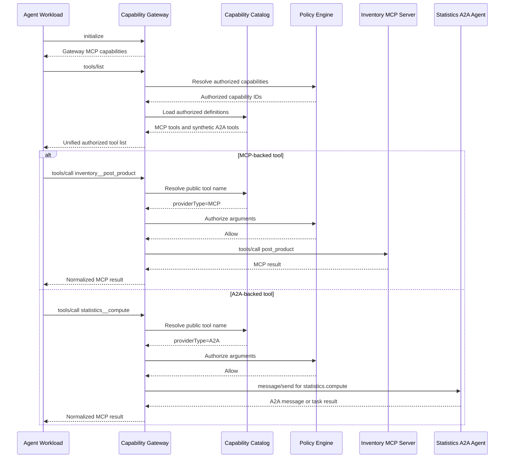
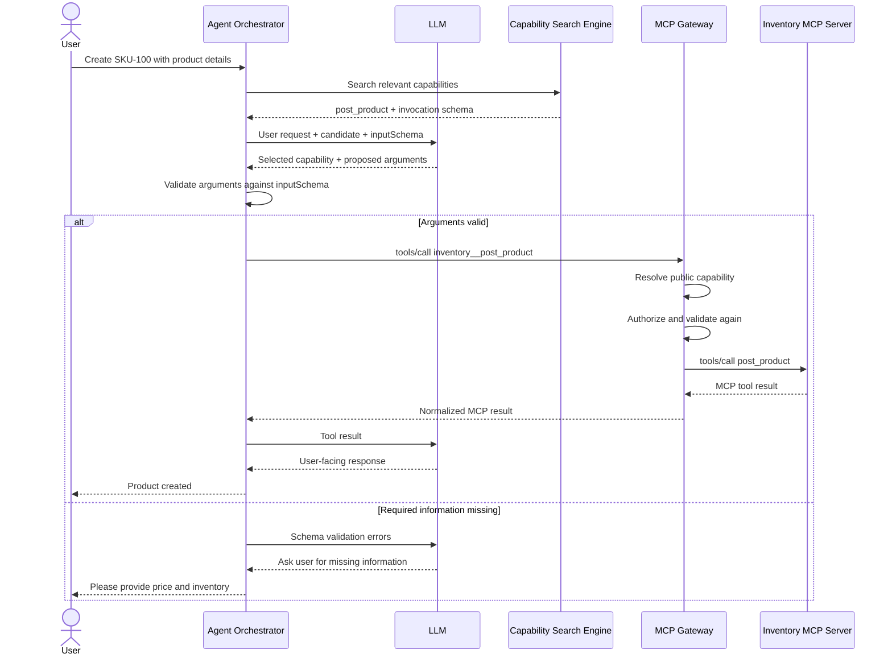

# py-mcp-gateway
go-mcp-gateway

## MCP Server Registry Repository

Repository layer for `mcp_server_registry` is implemented with:

- Domain contract: `McpServerRepository`
- PostgreSQL implementation: `PostgresMcpServerRepository`
- Database access: `asyncpg` pool + parameterized raw SQL
- Coverage for create/get/list/update/delete and exception mapping in integration tests

```json

# Discovery
{
  "serverId": "inventory-prod-02",
  "protocolVersion": "2025-06-18",
  "serverInfo": {
    "name": "inventory-mcp",
    "version": "2.4.1"
  },
  "capabilities": {
    "tools": {
      "listChanged": true
    },
    "prompts": {
      "listChanged": true
    },
    "resources": {
      "listChanged": true,
      "subscribe": true
    }
  },
  "tools": [],
  "prompts": [],
  "resources": [],
  "resourceTemplates": [],
  "discoveredAt": "2026-11-08T22:25:00-03:00",
  "contentHash": "sha256:..."
}
```

## Capability persistence (`capability_catalog`)

During discovery, capabilities are persisted with the complete original object in `payload` (`JSONB`).

`identifier` is populated as:

- Tool: `name`
- Prompt: `name`
- Resource: `uri`
- Resource template: `uriTemplate`


{
  "results": [
    {
      "capabilityId": "py-mcp-inventory-v2-01:TOOL:patch_product_inventory",
      "serverId": "py-mcp-inventory-v2-01",
      "capabilityType": "TOOL",
      "name": "patch_product_inventory",
      "description": "Updates inventory quantities for a product.",
      "score": 0.94
    },
    {
      "capabilityId": "py-mcp-inventory-v2-01:PROMPT:inventory_patch",
      "serverId": "py-mcp-inventory-v2-01",
      "capabilityType": "PROMPT",
      "name": "inventory_patch",
      "description": "Starts an inventory update workflow.",
      "score": 0.83
    }
  ]
}

Ranking Rules
Exact capability name match:        +100
Known inventory server:             +30
Domain equals inventory:            +25
Capability type TOOL:               +15
Input fields match request:         +15
Description phrase match:           +10
Prompt for matching workflow:       +5
Disabled capability:                exclude
Unauthorized capability:            exclude
Wrong environment:                   exclude

## Outbox pattern (`outbox_event`)

After discovery persists capabilities, the gateway writes an event in `outbox_event`
for asynchronous publication (for example, Kafka consumer/producer flow outside this service).

Schema:

```sql
CREATE TABLE public.outbox_event (
    id BIGSERIAL PRIMARY KEY,
    aggregate_type VARCHAR(50) NOT NULL,
    aggregate_id VARCHAR(150) NOT NULL,
    event_type VARCHAR(100) NOT NULL,
    payload JSONB NOT NULL,
    created_at TIMESTAMPTZ NOT NULL DEFAULT NOW(),
    published_at TIMESTAMPTZ,
    attempts INTEGER NOT NULL DEFAULT 0,
    last_error TEXT
);
```

Discovery now stores an OpenSearch-ready payload in `outbox_event.payload` with:

- `schemaVersion`, `eventType`, `operation`, `index`
- `serverId`, `catalogGeneration`, `discoveredAt`
- `documents[]` with deterministic `documentId = sha256("<server_id>:<capability_type>:<identifier>")`
- `statistics` (`tools`, `prompts`, `resources`, `resource_templates`, `total`)

## A2A Agent Registry (`a2a_agent_registry`)

A new A2A-prefixed registration flow was added to persist agent cards for future discovery.

- Endpoint: `POST /v1/a2a/service`
- Repository: `PostgresA2AAgentRepository`
- Use case: `A2ARegisteredAgentsUseCase`

Discovery endpoints:

- MCP: `POST /v1/discovery/{server_id}`
- A2A: `POST /v1/discovery/a2a/{agent_id}`

Request body:

```json
{
  "agent_id": "py-statistic-a2a-v2",
  "name": "Production py-statistic-a2a-v2 agent",
  "description": "Order lookup and reservation capabilities",
  "endpoint": {
    "url": "http://127.0.0.1:7600",
    "transport": "json-rpc"
  },
  "authentication": {
    "type": "oauth2",
    "audience": "py-statistic-a2a-v2"
  },
  "discovery": {
    "enabled": true,
    "refresh_interval_seconds": 900
  },
  "status": "ACTIVE",
  "created_at": "2026-11-03T20:20:00-03:00"
}
```



